# Cahier des charges fonctionnel — Gestion des dettes fournisseurs

**Version 1.0 — 07/11/2026** · Cible : PME tunisiennes (SCE, loi n° 96-112) · Bonnes pratiques internationales (IFRS)

---

## 1. Contexte et objectifs

Le logiciel couvre **l'intégralité du cycle fournisseurs**, de l'identification du fournisseur et de l'engagement d'achat jusqu'au règlement définitif de la dette, avec trois finalités :

1. **Gestion** : enregistrer, contrôler et suivre chaque pièce (commande, réception, facture, avoir, règlement, litige).
2. **Contrôle interne** : rapprochement à trois niveaux, séparation des tâches, circuits d'autorisation, piste d'audit infalsifiable.
3. **Pilotage financier** : savoir à tout moment ce que l'entreprise doit, à qui, pour quand, ce qu'elle s'est engagée à payer, et l'incidence sur la trésorerie.

Questions auxquelles le dirigeant et le DAF obtiennent une réponse immédiate :

| Question | Écran / état |
|---|---|
| Combien devons-nous à nos fournisseurs ? | Tableau de bord, balance âgée |
| Qu'est-ce qui est échu, qu'est-ce qui arrive à échéance ? | Échéancier, alertes |
| Quels engagements avons-nous pris sans facture reçue ? | Achats › Engagements non facturés |
| Que faut-il payer cette semaine, avec quelle trésorerie ? | Règlements › Préparation & optimisation |
| Quels fournisseurs présentent un risque ou une dépendance ? | Risques fournisseurs |
| Où pouvons-nous négocier un délai ou un escompte ? | Optimisation des paiements (justifications) |
| Quels décaissements à 7, 30, 60, 90 jours et 12 mois ? | Prévisions |

## 2. Périmètre

### 2.1 Livré dans la version 1.0 (fonctionnel, connecté à la base, testé)

| Module | Contenu |
|---|---|
| 1. Fichier fournisseurs | Fiche complète, classification, statuts, détection des doublons (matricule fiscal, raison sociale approchante, RIB), RIB à double contrôle, contrats, incidents, évaluations, historique achats/règlements |
| 2. Achats et engagements | Demandes d'achat avec validation, bons de commande avec approbation par seuil, révisions, annulation, clôture de reliquat, réceptions partielles et rejets, engagements non facturés, livraisons non facturées |
| 3. Factures | Saisie, import Excel/CSV, factures, avoirs, factures d'acompte, devises, TVA par ligne, timbre, retenue à la source, échéance calculée, pièces jointes, doublons |
| 4. Contrôle et validation | Rapprochement commande / réception / facture, 15 contrôles automatiques, tolérances paramétrables, circuit 1 à 3 niveaux selon montant, dérogation motivée du DAF |
| 5. Dettes et échéances | Soldes par fournisseur, échu / non échu, balance âgée à date (6 tranches), filtres devise / catégorie / fournisseur |
| 6. Règlements | Virement, chèque, effet, espèces, autre ; partiels, groupés, avances, non affectés, campagnes de paiement, autorisation simple ou double, exécution, rejets (chèque impayé, virement retourné), écarts de change, rapprochement bancaire |
| 7. Avoirs et litiges | Imputation des avoirs, litiges (prix, quantité, qualité, retour, retard, pénalité…), montant contesté exclu des paiements et des prévisions certaines |
| 8. Risques | Score explicable 0–100, niveaux paramétrables, dépendance, alertes contrats et prix |
| 9. Comptabilité | Écritures proposées automatiquement, validation, contre-passation, journaux, rapprochement auxiliaire / général, FNP, actualisation des dettes en devises, export CSV |
| 10. Pilotage | Prévisions certain / probable / conditionnel, optimisation des paiements, DPO, délai moyen, ponctualité, concentration |
| 11. Reporting | Tableau de bord, 13 états exportables Excel / PDF / CSV |
| 12. IA | Architecture d'extension ; fonctions déterministes et explicables déjà actives (doublons, prix anormaux, priorités, risques, prévisions) |
| Sécurité | 8 profils, 25 permissions, séparation des tâches, verrouillage de compte, sessions révocables, journal d'audit chaîné |

### 2.2 Hors périmètre de la version 1.0 (prévu dans l'architecture)

- Lecture automatique des factures (OCR) : point d'extension prêt, renvoie « non activé » (pas de faux résultat).
- Connexion directe aux banques (fichiers de virement normalisés, relevés automatiques) : import de relevé manuel/collé disponible.
- Interfaçage natif avec un logiciel comptable donné : export CSV générique disponible.
- Facturation électronique El Fatoora (côté fournisseur, émetteur) : à prévoir pour la **réception** de factures XML (voir § 9).
- Gestion des abonnements SaaS et console multi-entreprises (le modèle de données est déjà cloisonné par entreprise).

## 3. Acteurs et profils

| Profil | Rôle dans le cycle | Ne peut pas |
|---|---|---|
| Administrateur | Utilisateurs, paramétrage technique | Valider une facture, préparer ou autoriser un paiement |
| Directeur général | Approuve commandes au-delà du seuil, 3e niveau factures, 2e signature paiements | — |
| Directeur financier | Approuve demandes et commandes, 2e niveau factures, dérogations motivées, autorise les paiements, vérifie les RIB | Exécuter un paiement qu'il a autorisé |
| Responsable achats | Crée fournisseurs, demandes, bons de commande, réceptions, litiges | Approuver sa propre commande |
| Responsable comptable | Approuve fournisseurs, 1er niveau factures, valide écritures, clôture, paramètres fiscaux, rapprochements | Valider une facture qu'il a saisie ou réceptionnée |
| Agent comptable | Saisit/importe factures, réceptions, prépare règlements | Valider une facture |
| Trésorier | Prépare et exécute les paiements, rapprochement bancaire, cours de change | Autoriser un paiement |
| Consultation seule | Lecture de tous les états (auditeur, expert-comptable) | Toute modification |

La **matrice complète** (25 permissions × 8 profils) est consultable dans *Paramètres › Matrice des droits* et définie dans `backend/app/permissions.py`.

## 4. Cartographie des processus

**Enchaînement du cycle** : Demande d'achat → Validation (≠ demandeur) → Bon de commande → Approbation (DAF, DG au-delà du seuil) → Réception (≠ approbateur) → Facture fournisseur → Contrôles et rapprochement à trois niveaux → Validation 1 à 3 niveaux (≠ saisisseur, ≠ réceptionnaire) → Écriture d'achat → Échéance → Préparation du paiement → Autorisation 1 ou 2 signatures (≠ préparateur) → Décaissement (≠ autorisateur) → Écriture de règlement → Rapprochement bancaire → Mise à jour du solde fournisseur → Reporting et prévisions.

```mermaid
flowchart LR
  DA[Demande d'achat] -->|validation ≠ demandeur| BC[Bon de commande]
  BC -->|approbation DAF / DG selon seuil| ENG[(Engagement)]
  ENG --> BR[Réception<br/>≠ approbateur]
  BR --> FAC[Facture fournisseur]
  FAC --> CTRL{Contrôles<br/>3 niveaux}
  CTRL -->|anomalie bloquante| LIT[Litige / avoir / dérogation DAF]
  CTRL -->|conforme| VAL[Validation 1 à 3 niveaux<br/>≠ saisisseur ≠ réceptionnaire]
  VAL --> ECR1[Écriture ACH proposée]
  VAL --> ECH[Échéancier]
  ECH --> PREP[Préparation / optimisation]
  PREP -->|≠ préparateur| AUT[Autorisation 1 ou 2 signatures]
  AUT -->|≠ autorisateur| DEC[Décaissement]
  DEC --> ECR2[Écriture REG proposée]
  DEC --> RAP[Rapprochement bancaire]
  RAP --> SOLDE[Solde fournisseur à jour]
  SOLDE --> REP[Reporting, prévisions, KPI]
```

Chaque étape met à jour automatiquement les autres modules : la réception alimente le rapprochement et les factures non parvenues ; la validation alimente la dette, l'échéancier, la comptabilité et les prévisions ; le décaissement solde la facture, génère l'écriture et attend le relevé bancaire ; le rejet d'un chèque rétablit la dette et contre-passe l'écriture.

## 5. Règles de gestion

### 5.1 Fournisseurs
- **RG-F1** Code fournisseur unique par entreprise. Matricule fiscal identique à un fournisseur existant : création refusée sauf confirmation explicite (tracée).
- **RG-F2** Raison sociale proche (≥ 88 % de similarité après neutralisation des formes juridiques) ou RIB déjà attribué : avertissement.
- **RG-F3** Un fournisseur créé est « en attente » ; il doit être approuvé par une personne différente du créateur (paramètre `validation_fournisseur`).
- **RG-F4** Tout nouveau RIB remplace le précédent et doit être **vérifié par une autre personne** (contre-appel). Aucun virement vers un RIB non vérifié ; un RIB modifié entre l'autorisation et l'exécution bloque le paiement.
- **RG-F5** Format du matricule fiscal et clé du RIB tunisien (20 chiffres) contrôlés à titre d'alerte.
- **RG-F6** Un fournisseur bloqué ne peut recevoir ni commande ni paiement ; ses factures portent l'anomalie « fournisseur non autorisé ».

### 5.2 Achats
- **RG-A1** Le demandeur ne valide pas sa demande ; l'émetteur d'un BC ne l'approuve pas ; le demandeur ne l'approuve pas.
- **RG-A2** Commande ≥ `seuil_bc_validation_dg` (50 000 TND par défaut) : approbation du Directeur général.
- **RG-A3** Réception impossible par l'approbateur de la commande ; réception au-delà de la quantité commandée (+ tolérance) refusée.
- **RG-A4** Une commande approuvée modifiée repasse en brouillon (révision +1) et doit être ré-approuvée ; impossible si déjà réceptionnée ou facturée.
- **RG-A5** Engagement non facturé = quantités commandées non facturées × prix × (1 + TVA), pour les commandes approuvées non clôturées.

### 5.3 Factures
- **RG-I1** Montants : HT ligne = quantité × prix ; TVA ligne = HT × taux ; TTC = HT + TVA + timbre + autres taxes. Arrondi commercial au millime.
- **RG-I2** Timbre : montant paramétré appliqué par défaut aux factures de fournisseurs résidents (modifiable sur la pièce), jamais aux avoirs.
- **RG-I3** Retenue à la source : taux selon la nature paramétrée sur le fournisseur, appliquée si le TTC en TND atteint le seuil du taux ; base = TTC ; elle est **opérée au paiement** (prorata, le dernier règlement prend le reliquat exact). Dispense possible par le code « AUCUNE » (attestation).
- **RG-I4** Échéance = date de facture + délai (net) ou fin du mois correspondant (fin de mois), selon le BC sinon le fournisseur ; saisissable.
- **RG-I5** Une facture n'est modifiable qu'en brouillon. Une facture validée ne se supprime jamais : elle s'annule (si non réglée, avec motif et contre-passation) ou se corrige par avoir.
- **RG-I6** Doublon : même fournisseur + même numéro normalisé (« FA-00123 » = « fa 123 ») ⇒ bloquant ; même montant à ± 10 jours ⇒ avertissement.

### 5.4 Contrôles et validation (rapprochement à trois niveaux)
| Code | Contrôle | Gravité par défaut |
|---|---|---|
| FOURNISSEUR_NON_AUTORISE | Fournisseur non actif | Bloquante |
| DOUBLON / DOUBLON_SUSPECT | Voir RG-I6 | Bloquante / avertissement |
| DATE_FUTURE, DATE_RECEPTION | Cohérence des dates | Bloquante / avertissement |
| ERREUR_CALCUL | Ligne ≠ qté × PU ; total déclaré ≠ recalculé | Bloquante |
| TVA_INCOHERENTE | Taux non en vigueur, TVA ≠ base × taux, TVA facturée par un non-assujetti, taux ≠ commande | Bloquante |
| SANS_JUSTIFICATIF | Aucune pièce jointe | Bloquante (paramétrable) |
| SANS_BC | Facture sans commande | Bloquante si TTC ≥ `seuil_bc_obligatoire`, sinon avertissement |
| QTE_NON_RECEPTIONNEE | Cumul facturé > cumul réceptionné (+ tolérance) | Bloquante |
| QTE_SUP_COMMANDE | Cumul facturé > commandé | Bloquante |
| ECART_PRIX | Prix facturé > prix commandé + tolérance | Bloquante (avertissement dans la tolérance) |
| DEPASSEMENT_BC | Cumul HT facturé > montant commandé | Bloquante |
| REFERENCE, BC_AUTRE_FOURNISSEUR, BC_NON_APPROUVE, DEVISE | Cohérence des références | Bloquante |
| PRIX_ANORMAL | Prix > moyenne historique + `seuil_hausse_prix_pct` | Avertissement |
| PLAFOND_FOURNISSEUR | Encours > plafond d'engagement | Avertissement |

- **RG-V1** Niveaux requis selon le TTC en TND : 1 (responsable comptable / DAF / DG), 2 si ≥ `seuil_validation_n2` (DAF / DG), 3 si ≥ `seuil_validation_n3` (DG).
- **RG-V2** Le saisisseur, le réceptionnaire et un même valideur ne peuvent pas valider (deux niveaux distincts = deux personnes).
- **RG-V3** Anomalie bloquante : validation impossible, sauf **dérogation du DAF** avec justification écrite (≥ 15 caractères), conservée et visible.
- **RG-V4** La validation finale met à jour les quantités facturées du BC, la dette, l'échéancier et propose l'écriture d'achat.

### 5.5 Règlements
- **RG-P1** Montant payable = solde − montants en litige − montants déjà en préparation (anti double paiement).
- **RG-P2** Le préparateur n'autorise pas ; l'autorisateur n'exécute pas. Au-delà de `seuil_paiement_double_signature` : seconde signature du DG.
- **RG-P3** La dette n'est réduite qu'au décaissement effectif (statut émis). Chèque rejeté / virement retourné : affectations annulées, dette rétablie, écritures contre-passées.
- **RG-P4** Avance : comptabilisée au 409, imputable ultérieurement sur une facture (écriture 401/409). Paiement non affecté : reste au débit du 401 jusqu'à affectation.
- **RG-P5** Devises : la facture est enregistrée au cours du jour de facture, le paiement au cours du jour de paiement ; la différence est une perte (655) ou un gain (755) de change réalisé.
- **RG-P6** Paiement en espèces au-delà de `seuil_especes` : alerte fiscale (le régime a évolué avec la LF 2026, voir § 9).

### 5.6 Litiges et avoirs
- **RG-L1** Le montant contesté ne peut excéder le solde dû ; il est exclu des paiements et classé « conditionnel » dans les prévisions.
- **RG-L2** Un litige ne se résout ou ne se clôt qu'avec une décision écrite ; il passe au statut clos non modifiable.
- **RG-L3** Un avoir s'impute sur une facture du même fournisseur et de même devise, dans la limite de son disponible et du solde de la facture.
- **RG-L4** Une facture d'acompte payée s'impute sur la facture définitive (écriture D 401 / C 409 HT / C TVA déductible).

### 5.7 Comptabilité et clôture
- **RG-C1** Toute écriture est équilibrée (contrôle bloquant) ; elle est proposée puis validée par le responsable comptable ; validée = non modifiable.
- **RG-C2** Date de clôture paramétrable : aucune opération ni validation d'écriture à cette date ou avant.
- **RG-C3** Le solde auxiliaire (reconstitué depuis les pièces) est rapproché en permanence du solde général (écritures 401 + 404), par fournisseur.

## 6. Cas particuliers traités

| Cas | Traitement |
|---|---|
| Livraison partielle puis factures partielles | Contrôle sur cumuls réceptionnés / facturés |
| Marchandise non conforme | Quantité rejetée à la réception, non facturable ; litige « retour » |
| Facture sans BC (honoraires, services récurrents) | Avertissement sous le seuil ; au-delà, dérogation DAF motivée |
| Facture en devise | Cours BCT saisi à la date ; écart de change au paiement ; actualisation à la clôture (extournée) |
| Fournisseur d'immobilisations | Compte 404 et TVA sur immobilisations (43661) déterminés par le compte de la ligne (classe 2) |
| Effet de commerce | 401 → 403 à l'émission, 403 → banque à l'échéance |
| Facture validée par erreur | Annulation motivée si non réglée (contre-passation), sinon avoir |
| Changement de RIB frauduleux (« fraude au président ») | RIB remplacé, à vérifier par une autre personne, paiement bloqué |
| Réceptions non facturées à la clôture | État FNP + écriture 408 extournée |
| Taux fiscal qui change | Nouveau taux daté ; l'ancien est clos ; les pièces anciennes gardent leur taux |

## 7. Scénarios d'utilisation (extraits)

1. **Achat courant** : l'agent crée une demande ; le DAF l'approuve ; le responsable achats émet le BC ; le DAF l'approuve ; l'agent réceptionne ; l'agent saisit la facture et joint le PDF ; contrôles conformes ; le responsable comptable valide ; écriture proposée puis validée.
2. **Paiement hebdomadaire** : le trésorier ouvre *Préparation & optimisation*, fixe la trésorerie mobilisable, retient les factures proposées (justification affichée), crée la campagne ; le DAF autorise ; au-delà du seuil le DG co-signe ; le trésorier exécute ; le relevé bancaire importé rapproche automatiquement.
3. **Litige qualité** : le responsable achats ouvre un litige de 1 200 TND sur la facture ; le payable est réduit d'autant ; à la résolution, un avoir est saisi et imputé.
4. **Clôture mensuelle** : FNP, actualisation devises, validation des écritures, rapprochement auxiliaire/général, export vers le logiciel comptable, date de clôture avancée.

## 8. Exigences non fonctionnelles

- Interface française, architecture multilingue (arabe RTL, anglais), montants à 3 décimales, dates JJ/MM/AAAA, devise de référence TND.
- Responsive (ordinateur, tablette, smartphone), recherche globale, filtres, graphiques, alertes.
- Données persistantes PostgreSQL ; migrations versionnées ; sauvegarde/restauration scriptées et testées.
- Traçabilité : chaque action sensible journalisée (utilisateur, date, IP, avant/après), chaînage SHA-256 vérifiable.
- Paramétrage sans modification du code : taux datés, plan de comptes, seuils, tolérances.

## 9. Cadre réglementaire — distinction Tunisie / IFRS

Voir `08-referentiel-reglementaire.md` pour le détail, les sources consultées et les points à confirmer.

## 10. Hypothèses retenues et angles morts signalés

| # | Sujet | Hypothèse / décision | Action recommandée |
|---|---|---|---|
| H1 | Taux fiscaux | Relevés le 07/11/2026 sur sources secondaires divergentes ; tous marqués « à vérifier » | Validation par l'expert-comptable avant production |
| H2 | Retenue à la source | Base TTC, opérée au paiement, seuil 1 000 DT pour les acquisitions | Confirmer les natures d'opérations propres à chaque client (loyers, honoraires, non-résidents) |
| H3 | Paiements en espèces | La LF 2026 (art. 54 selon la presse) aurait abrogé l'obligation de paiement non-espèces au-delà de 5 000 DT ; une alerte est conservée | Confirmer le régime de déductibilité et de pénalité |
| H4 | Facturation électronique | Obligation étendue aux prestataires de services en 2026 (El Fatoora) ; le logiciel reçoit des PDF/Excel | Prévoir l'import des factures XML TEIF dans une version ultérieure |
| H5 | Écarts de change latents | Actualisation en résultat avec extourne ; traitement NC 15 / IAS 21 à confirmer (écarts de conversion au bilan possibles) | Arbitrage de l'expert-comptable |
| H6 | Plan de comptes | Comptes SCE usuels (401, 403, 404, 408, 409, 4366x, 432, 655, 755, 532, 54) paramétrables | Aligner sur le plan de chaque client |
| H7 | Délais de paiement légaux | Aucun plafond légal général codé ; délais contractuels | Vérifier les textes sectoriels et marchés publics éventuels |
| H8 | Retenue de TVA (25 %) | Non activée par défaut (concerne surtout l'État et certaines entreprises) | Ajouter un taux « AUTRE » si le client y est soumis |
| H9 | Conservation | Les pièces ne sont jamais supprimées par l'application ; durée légale de conservation (10 ans) à garantir par la politique de sauvegarde | Archivage externe des sauvegardes |
