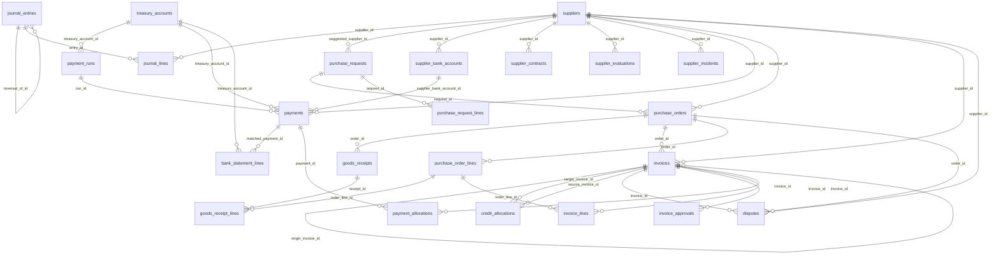

# Schéma de la base de données

_Document généré automatiquement depuis `backend/app/models.py` (`python scripts/schema_doc.py`)._

Conventions : montants `NUMERIC(18,3)` (dinar à 3 décimales), taux de change `NUMERIC(18,6)`, chaque table métier porte `company_id` (cloisonnement multi-entreprises).

## Diagramme des relations

## `companies`

| Colonne | Type | Nul | Clé / référence |
|---|---|---|---|
| `id` | INTEGER | non | PK |
| `name` | VARCHAR(200) | non |  |
| `tax_id` | VARCHAR(40) | oui |  |
| `address` | VARCHAR(300) | oui |  |
| `base_currency` | VARCHAR(3) | non |  |
| `is_demo` | BOOLEAN | non |  |
| `created_at` | DATETIME | non |  |

## `account_mappings`

| Colonne | Type | Nul | Clé / référence |
|---|---|---|---|
| `id` | INTEGER | non | PK |
| `key` | VARCHAR(60) | non |  |
| `account_code` | VARCHAR(20) | non |  |
| `label` | VARCHAR(200) | non |  |
| `company_id` | INTEGER | non | → companies.id |
| `created_at` | DATETIME | non |  |
| `updated_at` | DATETIME | non |  |

Contraintes d'unicité : (company_id, key)

## `exchange_rates`

| Colonne | Type | Nul | Clé / référence |
|---|---|---|---|
| `id` | INTEGER | non | PK |
| `currency` | VARCHAR(3) | non |  |
| `rate_date` | DATE | non |  |
| `rate` | NUMERIC(18, 6) | non |  |
| `source` | VARCHAR(100) | oui |  |
| `company_id` | INTEGER | non | → companies.id |
| `created_at` | DATETIME | non |  |
| `updated_at` | DATETIME | non |  |

Contraintes d'unicité : (company_id, currency, rate_date)

## `sequences`

| Colonne | Type | Nul | Clé / référence |
|---|---|---|---|
| `id` | INTEGER | non | PK |
| `prefix` | VARCHAR(10) | non |  |
| `year` | INTEGER | non |  |
| `last_number` | INTEGER | non |  |
| `company_id` | INTEGER | non | → companies.id |
| `created_at` | DATETIME | non |  |
| `updated_at` | DATETIME | non |  |

Contraintes d'unicité : (company_id, prefix, year)

## `settings`

| Colonne | Type | Nul | Clé / référence |
|---|---|---|---|
| `id` | INTEGER | non | PK |
| `key` | VARCHAR(80) | non |  |
| `value` | VARCHAR(500) | non |  |
| `label` | VARCHAR(300) | oui |  |
| `company_id` | INTEGER | non | → companies.id |
| `created_at` | DATETIME | non |  |
| `updated_at` | DATETIME | non |  |

Contraintes d'unicité : (company_id, key)

## `tax_rates`

| Colonne | Type | Nul | Clé / référence |
|---|---|---|---|
| `id` | INTEGER | non | PK |
| `kind` | VARCHAR(20) | non |  |
| `code` | VARCHAR(40) | non |  |
| `label` | VARCHAR(300) | non |  |
| `rate` | NUMERIC(9, 4) | non |  |
| `fixed_amount` | NUMERIC(18, 3) | non |  |
| `threshold` | NUMERIC(18, 3) | non |  |
| `account_code` | VARCHAR(20) | oui |  |
| `valid_from` | DATE | non |  |
| `valid_to` | DATE | oui |  |
| `legal_reference` | VARCHAR(300) | oui |  |
| `verified_on` | DATE | oui |  |
| `to_verify` | BOOLEAN | non |  |
| `is_active` | BOOLEAN | non |  |
| `company_id` | INTEGER | non | → companies.id |
| `created_at` | DATETIME | non |  |
| `updated_at` | DATETIME | non |  |

## `treasury_accounts`

| Colonne | Type | Nul | Clé / référence |
|---|---|---|---|
| `id` | INTEGER | non | PK |
| `name` | VARCHAR(120) | non |  |
| `kind` | VARCHAR(10) | non |  |
| `bank_name` | VARCHAR(120) | oui |  |
| `rib` | VARCHAR(40) | oui |  |
| `currency` | VARCHAR(3) | non |  |
| `account_code` | VARCHAR(20) | non |  |
| `opening_balance` | NUMERIC(18, 3) | non |  |
| `opening_date` | DATE | oui |  |
| `authorized_overdraft` | NUMERIC(18, 3) | non |  |
| `is_active` | BOOLEAN | non |  |
| `company_id` | INTEGER | non | → companies.id |
| `created_at` | DATETIME | non |  |
| `updated_at` | DATETIME | non |  |

## `users`

| Colonne | Type | Nul | Clé / référence |
|---|---|---|---|
| `id` | INTEGER | non | PK |
| `email` | VARCHAR(200) | non |  |
| `full_name` | VARCHAR(200) | non |  |
| `role` | VARCHAR(30) | non |  |
| `password_hash` | VARCHAR(300) | non |  |
| `is_active` | BOOLEAN | non |  |
| `failed_logins` | INTEGER | non |  |
| `locked_until` | DATETIME | oui |  |
| `last_login` | DATETIME | oui |  |
| `language` | VARCHAR(5) | non |  |
| `company_id` | INTEGER | non | → companies.id |
| `created_at` | DATETIME | non |  |
| `updated_at` | DATETIME | non |  |

Contraintes d'unicité : (email)

## `attachments`

| Colonne | Type | Nul | Clé / référence |
|---|---|---|---|
| `id` | INTEGER | non | PK |
| `entity` | VARCHAR(40) | non |  |
| `entity_id` | INTEGER | non |  |
| `filename` | VARCHAR(255) | non |  |
| `content_type` | VARCHAR(100) | oui |  |
| `size` | INTEGER | non |  |
| `sha256` | VARCHAR(64) | non |  |
| `storage_path` | VARCHAR(500) | non |  |
| `doc_type` | VARCHAR(60) | oui |  |
| `uploaded_by_id` | INTEGER | oui | → users.id |
| `company_id` | INTEGER | non | → companies.id |
| `created_at` | DATETIME | non |  |
| `updated_at` | DATETIME | non |  |

## `audit_logs`

| Colonne | Type | Nul | Clé / référence |
|---|---|---|---|
| `id` | INTEGER | non | PK |
| `company_id` | INTEGER | oui | → companies.id |
| `user_id` | INTEGER | oui | → users.id |
| `user_label` | VARCHAR(200) | oui |  |
| `timestamp` | DATETIME | non |  |
| `action` | VARCHAR(60) | non |  |
| `entity` | VARCHAR(60) | non |  |
| `entity_id` | VARCHAR(40) | oui |  |
| `details` | JSON | oui |  |
| `ip` | VARCHAR(64) | oui |  |
| `prev_hash` | VARCHAR(64) | oui |  |
| `hash` | VARCHAR(64) | non |  |

## `journal_entries`

| Colonne | Type | Nul | Clé / référence |
|---|---|---|---|
| `id` | INTEGER | non | PK |
| `journal` | VARCHAR(10) | non |  |
| `number` | VARCHAR(30) | non |  |
| `entry_date` | DATE | non |  |
| `label` | VARCHAR(300) | non |  |
| `source_type` | VARCHAR(30) | non |  |
| `source_id` | INTEGER | oui |  |
| `status` | VARCHAR(15) | non |  |
| `validated_by_id` | INTEGER | oui | → users.id |
| `validated_at` | DATETIME | oui |  |
| `reversal_of_id` | INTEGER | oui | → journal_entries.id |
| `exported_at` | DATETIME | oui |  |
| `company_id` | INTEGER | non | → companies.id |
| `created_at` | DATETIME | non |  |
| `updated_at` | DATETIME | non |  |

## `payment_runs`

| Colonne | Type | Nul | Clé / référence |
|---|---|---|---|
| `id` | INTEGER | non | PK |
| `number` | VARCHAR(30) | non |  |
| `planned_date` | DATE | non |  |
| `treasury_account_id` | INTEGER | oui | → treasury_accounts.id |
| `status` | VARCHAR(20) | non |  |
| `notes` | TEXT | oui |  |
| `created_by_id` | INTEGER | oui | → users.id |
| `company_id` | INTEGER | non | → companies.id |
| `created_at` | DATETIME | non |  |
| `updated_at` | DATETIME | non |  |

## `suppliers`

| Colonne | Type | Nul | Clé / référence |
|---|---|---|---|
| `id` | INTEGER | non | PK |
| `code` | VARCHAR(20) | non |  |
| `legal_name` | VARCHAR(200) | non |  |
| `trade_name` | VARCHAR(200) | oui |  |
| `tax_id` | VARCHAR(40) | oui |  |
| `tax_id_normalized` | VARCHAR(40) | oui |  |
| `address` | VARCHAR(300) | oui |  |
| `city` | VARCHAR(100) | oui |  |
| `country` | VARCHAR(2) | non |  |
| `phone` | VARCHAR(50) | oui |  |
| `email` | VARCHAR(200) | oui |  |
| `contact_name` | VARCHAR(200) | oui |  |
| `sector` | VARCHAR(100) | oui |  |
| `supply_nature` | VARCHAR(300) | oui |  |
| `category` | VARCHAR(20) | non |  |
| `status` | VARCHAR(20) | non |  |
| `is_resident` | BOOLEAN | non |  |
| `vat_regime` | VARCHAR(20) | non |  |
| `rs_code` | VARCHAR(40) | oui |  |
| `currency` | VARCHAR(3) | non |  |
| `payment_terms_days` | INTEGER | non |  |
| `payment_terms_type` | VARCHAR(20) | non |  |
| `early_discount_pct` | NUMERIC(9, 4) | non |  |
| `early_discount_days` | INTEGER | non |  |
| `late_penalty_pct` | NUMERIC(9, 4) | non |  |
| `credit_limit` | NUMERIC(18, 3) | oui |  |
| `default_account` | VARCHAR(20) | oui |  |
| `contract_terms` | TEXT | oui |  |
| `notes` | TEXT | oui |  |
| `created_by_id` | INTEGER | oui | → users.id |
| `approved_by_id` | INTEGER | oui | → users.id |
| `approved_at` | DATETIME | oui |  |
| `company_id` | INTEGER | non | → companies.id |
| `created_at` | DATETIME | non |  |
| `updated_at` | DATETIME | non |  |

Contraintes d'unicité : (company_id, code)

## `user_sessions`

| Colonne | Type | Nul | Clé / référence |
|---|---|---|---|
| `id` | INTEGER | non | PK |
| `user_id` | INTEGER | non | → users.id |
| `jti` | VARCHAR(64) | non |  |
| `created_at` | DATETIME | non |  |
| `last_seen` | DATETIME | non |  |
| `expires_at` | DATETIME | non |  |
| `revoked` | BOOLEAN | non |  |
| `ip` | VARCHAR(64) | oui |  |

Contraintes d'unicité : (jti)

## `journal_lines`

| Colonne | Type | Nul | Clé / référence |
|---|---|---|---|
| `id` | INTEGER | non | PK |
| `entry_id` | INTEGER | non | → journal_entries.id |
| `account_code` | VARCHAR(20) | non |  |
| `supplier_id` | INTEGER | oui | → suppliers.id |
| `label` | VARCHAR(300) | non |  |
| `debit` | NUMERIC(18, 3) | non |  |
| `credit` | NUMERIC(18, 3) | non |  |

## `purchase_requests`

| Colonne | Type | Nul | Clé / référence |
|---|---|---|---|
| `id` | INTEGER | non | PK |
| `number` | VARCHAR(30) | non |  |
| `request_date` | DATE | non |  |
| `requester_id` | INTEGER | non | → users.id |
| `department` | VARCHAR(100) | oui |  |
| `justification` | TEXT | oui |  |
| `suggested_supplier_id` | INTEGER | oui | → suppliers.id |
| `estimated_amount` | NUMERIC(18, 3) | non |  |
| `needed_by` | DATE | oui |  |
| `status` | VARCHAR(20) | non |  |
| `approved_by_id` | INTEGER | oui | → users.id |
| `approved_at` | DATETIME | oui |  |
| `decision_comment` | VARCHAR(500) | oui |  |
| `company_id` | INTEGER | non | → companies.id |
| `created_at` | DATETIME | non |  |
| `updated_at` | DATETIME | non |  |

## `supplier_bank_accounts`

| Colonne | Type | Nul | Clé / référence |
|---|---|---|---|
| `id` | INTEGER | non | PK |
| `supplier_id` | INTEGER | non | → suppliers.id |
| `bank_name` | VARCHAR(120) | non |  |
| `rib` | VARCHAR(40) | oui |  |
| `iban` | VARCHAR(40) | oui |  |
| `swift` | VARCHAR(20) | oui |  |
| `currency` | VARCHAR(3) | non |  |
| `status` | VARCHAR(20) | non |  |
| `created_by_id` | INTEGER | oui | → users.id |
| `verified_by_id` | INTEGER | oui | → users.id |
| `verified_at` | DATETIME | oui |  |
| `verification_note` | VARCHAR(300) | oui |  |
| `company_id` | INTEGER | non | → companies.id |
| `created_at` | DATETIME | non |  |
| `updated_at` | DATETIME | non |  |

## `supplier_contracts`

| Colonne | Type | Nul | Clé / référence |
|---|---|---|---|
| `id` | INTEGER | non | PK |
| `supplier_id` | INTEGER | non | → suppliers.id |
| `reference` | VARCHAR(60) | non |  |
| `subject` | VARCHAR(300) | non |  |
| `start_date` | DATE | non |  |
| `end_date` | DATE | oui |  |
| `total_amount` | NUMERIC(18, 3) | oui |  |
| `recurring_amount_ttc` | NUMERIC(18, 3) | non |  |
| `frequency_months` | INTEGER | non |  |
| `next_due_date` | DATE | oui |  |
| `notice_days` | INTEGER | non |  |
| `status` | VARCHAR(20) | non |  |
| `company_id` | INTEGER | non | → companies.id |
| `created_at` | DATETIME | non |  |
| `updated_at` | DATETIME | non |  |

## `supplier_evaluations`

| Colonne | Type | Nul | Clé / référence |
|---|---|---|---|
| `id` | INTEGER | non | PK |
| `supplier_id` | INTEGER | non | → suppliers.id |
| `period` | VARCHAR(10) | non |  |
| `quality` | INTEGER | non |  |
| `delivery` | INTEGER | non |  |
| `compliance` | INTEGER | non |  |
| `strategic_importance` | INTEGER | non |  |
| `supply_risk` | INTEGER | non |  |
| `comment` | TEXT | oui |  |
| `evaluated_by_id` | INTEGER | oui | → users.id |
| `company_id` | INTEGER | non | → companies.id |
| `created_at` | DATETIME | non |  |
| `updated_at` | DATETIME | non |  |

## `supplier_incidents`

| Colonne | Type | Nul | Clé / référence |
|---|---|---|---|
| `id` | INTEGER | non | PK |
| `supplier_id` | INTEGER | non | → suppliers.id |
| `incident_date` | DATE | non |  |
| `kind` | VARCHAR(30) | non |  |
| `severity` | VARCHAR(10) | non |  |
| `description` | TEXT | non |  |
| `created_by_id` | INTEGER | oui | → users.id |
| `company_id` | INTEGER | non | → companies.id |
| `created_at` | DATETIME | non |  |
| `updated_at` | DATETIME | non |  |

## `payments`

| Colonne | Type | Nul | Clé / référence |
|---|---|---|---|
| `id` | INTEGER | non | PK |
| `number` | VARCHAR(30) | non |  |
| `run_id` | INTEGER | oui | → payment_runs.id |
| `supplier_id` | INTEGER | non | → suppliers.id |
| `kind` | VARCHAR(10) | non |  |
| `method` | VARCHAR(15) | non |  |
| `treasury_account_id` | INTEGER | oui | → treasury_accounts.id |
| `supplier_bank_account_id` | INTEGER | oui | → supplier_bank_accounts.id |
| `payment_date` | DATE | non |  |
| `due_date` | DATE | oui |  |
| `reference` | VARCHAR(60) | oui |  |
| `currency` | VARCHAR(3) | non |  |
| `exchange_rate` | NUMERIC(18, 6) | non |  |
| `cash_amount` | NUMERIC(18, 3) | non |  |
| `rs_amount` | NUMERIC(18, 3) | non |  |
| `status` | VARCHAR(20) | non |  |
| `required_approvals` | INTEGER | non |  |
| `prepared_by_id` | INTEGER | oui | → users.id |
| `approved_by_id` | INTEGER | oui | → users.id |
| `second_approver_id` | INTEGER | oui | → users.id |
| `executed_by_id` | INTEGER | oui | → users.id |
| `cleared_date` | DATE | oui |  |
| `rejection_reason` | VARCHAR(500) | oui |  |
| `rejected_date` | DATE | oui |  |
| `notes` | TEXT | oui |  |
| `company_id` | INTEGER | non | → companies.id |
| `created_at` | DATETIME | non |  |
| `updated_at` | DATETIME | non |  |

## `purchase_orders`

| Colonne | Type | Nul | Clé / référence |
|---|---|---|---|
| `id` | INTEGER | non | PK |
| `number` | VARCHAR(30) | non |  |
| `supplier_id` | INTEGER | non | → suppliers.id |
| `request_id` | INTEGER | oui | → purchase_requests.id |
| `order_date` | DATE | non |  |
| `expected_date` | DATE | oui |  |
| `currency` | VARCHAR(3) | non |  |
| `exchange_rate` | NUMERIC(18, 6) | non |  |
| `payment_terms_days` | INTEGER | non |  |
| `payment_terms_type` | VARCHAR(20) | non |  |
| `total_ht` | NUMERIC(18, 3) | non |  |
| `total_tva` | NUMERIC(18, 3) | non |  |
| `total_ttc` | NUMERIC(18, 3) | non |  |
| `status` | VARCHAR(25) | non |  |
| `notes` | TEXT | oui |  |
| `created_by_id` | INTEGER | oui | → users.id |
| `approved_by_id` | INTEGER | oui | → users.id |
| `approved_at` | DATETIME | oui |  |
| `cancel_reason` | VARCHAR(500) | oui |  |
| `revision` | INTEGER | non |  |
| `company_id` | INTEGER | non | → companies.id |
| `created_at` | DATETIME | non |  |
| `updated_at` | DATETIME | non |  |

## `purchase_request_lines`

| Colonne | Type | Nul | Clé / référence |
|---|---|---|---|
| `id` | INTEGER | non | PK |
| `request_id` | INTEGER | non | → purchase_requests.id |
| `description` | VARCHAR(300) | non |  |
| `quantity` | NUMERIC(18, 3) | non |  |
| `estimated_unit_price` | NUMERIC(18, 3) | non |  |

## `bank_statement_lines`

| Colonne | Type | Nul | Clé / référence |
|---|---|---|---|
| `id` | INTEGER | non | PK |
| `treasury_account_id` | INTEGER | non | → treasury_accounts.id |
| `operation_date` | DATE | non |  |
| `label` | VARCHAR(300) | non |  |
| `reference` | VARCHAR(60) | oui |  |
| `amount` | NUMERIC(18, 3) | non |  |
| `matched_payment_id` | INTEGER | oui | → payments.id |
| `import_batch` | VARCHAR(40) | oui |  |
| `company_id` | INTEGER | non | → companies.id |
| `created_at` | DATETIME | non |  |
| `updated_at` | DATETIME | non |  |

## `goods_receipts`

| Colonne | Type | Nul | Clé / référence |
|---|---|---|---|
| `id` | INTEGER | non | PK |
| `number` | VARCHAR(30) | non |  |
| `order_id` | INTEGER | non | → purchase_orders.id |
| `receipt_date` | DATE | non |  |
| `delivery_note_ref` | VARCHAR(60) | oui |  |
| `received_by_id` | INTEGER | oui | → users.id |
| `status` | VARCHAR(20) | non |  |
| `notes` | TEXT | oui |  |
| `company_id` | INTEGER | non | → companies.id |
| `created_at` | DATETIME | non |  |
| `updated_at` | DATETIME | non |  |

## `invoices`

| Colonne | Type | Nul | Clé / référence |
|---|---|---|---|
| `id` | INTEGER | non | PK |
| `internal_ref` | VARCHAR(30) | non |  |
| `doc_type` | VARCHAR(15) | non |  |
| `supplier_id` | INTEGER | non | → suppliers.id |
| `supplier_number` | VARCHAR(60) | non |  |
| `number_normalized` | VARCHAR(60) | non |  |
| `invoice_date` | DATE | non |  |
| `reception_date` | DATE | oui |  |
| `order_id` | INTEGER | oui | → purchase_orders.id |
| `receipt_refs` | VARCHAR(200) | oui |  |
| `origin_invoice_id` | INTEGER | oui | → invoices.id |
| `currency` | VARCHAR(3) | non |  |
| `exchange_rate` | NUMERIC(18, 6) | non |  |
| `total_ht` | NUMERIC(18, 3) | non |  |
| `total_tva` | NUMERIC(18, 3) | non |  |
| `stamp_duty` | NUMERIC(18, 3) | non |  |
| `other_taxes` | NUMERIC(18, 3) | non |  |
| `total_ttc` | NUMERIC(18, 3) | non |  |
| `declared_total_ttc` | NUMERIC(18, 3) | oui |  |
| `rs_code` | VARCHAR(40) | oui |  |
| `rs_rate` | NUMERIC(9, 4) | non |  |
| `rs_amount` | NUMERIC(18, 3) | non |  |
| `net_to_pay` | NUMERIC(18, 3) | non |  |
| `total_ttc_tnd` | NUMERIC(18, 3) | non |  |
| `due_date` | DATE | oui |  |
| `workflow_status` | VARCHAR(25) | non |  |
| `matching_status` | VARCHAR(20) | non |  |
| `anomalies` | JSON | oui |  |
| `required_levels` | INTEGER | non |  |
| `approved_levels` | INTEGER | non |  |
| `forced` | BOOLEAN | non |  |
| `force_justification` | TEXT | oui |  |
| `cancel_reason` | VARCHAR(500) | oui |  |
| `cancelled_at` | DATE | oui |  |
| `description` | VARCHAR(300) | oui |  |
| `source` | VARCHAR(20) | non |  |
| `created_by_id` | INTEGER | oui | → users.id |
| `validated_at` | DATETIME | oui |  |
| `company_id` | INTEGER | non | → companies.id |
| `created_at` | DATETIME | non |  |
| `updated_at` | DATETIME | non |  |

## `purchase_order_lines`

| Colonne | Type | Nul | Clé / référence |
|---|---|---|---|
| `id` | INTEGER | non | PK |
| `order_id` | INTEGER | non | → purchase_orders.id |
| `item_ref` | VARCHAR(60) | oui |  |
| `description` | VARCHAR(300) | non |  |
| `quantity` | NUMERIC(18, 3) | non |  |
| `unit_price` | NUMERIC(18, 3) | non |  |
| `tva_rate` | NUMERIC(9, 4) | non |  |
| `account_code` | VARCHAR(20) | oui |  |
| `qty_received` | NUMERIC(18, 3) | non |  |
| `qty_invoiced` | NUMERIC(18, 3) | non |  |

## `credit_allocations`

| Colonne | Type | Nul | Clé / référence |
|---|---|---|---|
| `id` | INTEGER | non | PK |
| `kind` | VARCHAR(10) | non |  |
| `source_invoice_id` | INTEGER | non | → invoices.id |
| `target_invoice_id` | INTEGER | non | → invoices.id |
| `amount` | NUMERIC(18, 3) | non |  |
| `allocation_date` | DATE | non |  |
| `created_by_id` | INTEGER | oui | → users.id |
| `cancelled` | BOOLEAN | non |  |
| `company_id` | INTEGER | non | → companies.id |
| `created_at` | DATETIME | non |  |
| `updated_at` | DATETIME | non |  |

## `disputes`

| Colonne | Type | Nul | Clé / référence |
|---|---|---|---|
| `id` | INTEGER | non | PK |
| `number` | VARCHAR(30) | non |  |
| `supplier_id` | INTEGER | non | → suppliers.id |
| `invoice_id` | INTEGER | oui | → invoices.id |
| `order_id` | INTEGER | oui | → purchase_orders.id |
| `kind` | VARCHAR(25) | non |  |
| `contested_amount` | NUMERIC(18, 3) | non |  |
| `returned_quantity` | NUMERIC(18, 3) | oui |  |
| `penalty_amount` | NUMERIC(18, 3) | oui |  |
| `reason` | TEXT | non |  |
| `opened_at` | DATE | non |  |
| `owner_id` | INTEGER | oui | → users.id |
| `status` | VARCHAR(15) | non |  |
| `progress_notes` | TEXT | oui |  |
| `decision` | TEXT | oui |  |
| `outcome` | VARCHAR(30) | oui |  |
| `closed_at` | DATE | oui |  |
| `created_by_id` | INTEGER | oui | → users.id |
| `company_id` | INTEGER | non | → companies.id |
| `created_at` | DATETIME | non |  |
| `updated_at` | DATETIME | non |  |

## `goods_receipt_lines`

| Colonne | Type | Nul | Clé / référence |
|---|---|---|---|
| `id` | INTEGER | non | PK |
| `receipt_id` | INTEGER | non | → goods_receipts.id |
| `order_line_id` | INTEGER | non | → purchase_order_lines.id |
| `qty_received` | NUMERIC(18, 3) | non |  |
| `qty_rejected` | NUMERIC(18, 3) | non |  |
| `comment` | VARCHAR(300) | oui |  |

## `invoice_approvals`

| Colonne | Type | Nul | Clé / référence |
|---|---|---|---|
| `id` | INTEGER | non | PK |
| `invoice_id` | INTEGER | non | → invoices.id |
| `level` | INTEGER | non |  |
| `user_id` | INTEGER | non | → users.id |
| `decision` | VARCHAR(15) | non |  |
| `comment` | TEXT | oui |  |
| `company_id` | INTEGER | non | → companies.id |
| `created_at` | DATETIME | non |  |
| `updated_at` | DATETIME | non |  |

## `invoice_lines`

| Colonne | Type | Nul | Clé / référence |
|---|---|---|---|
| `id` | INTEGER | non | PK |
| `invoice_id` | INTEGER | non | → invoices.id |
| `order_line_id` | INTEGER | oui | → purchase_order_lines.id |
| `item_ref` | VARCHAR(60) | oui |  |
| `description` | VARCHAR(300) | non |  |
| `quantity` | NUMERIC(18, 3) | non |  |
| `unit_price` | NUMERIC(18, 3) | non |  |
| `tva_rate` | NUMERIC(9, 4) | non |  |
| `amount_ht` | NUMERIC(18, 3) | non |  |
| `amount_tva` | NUMERIC(18, 3) | non |  |
| `account_code` | VARCHAR(20) | oui |  |

## `payment_allocations`

| Colonne | Type | Nul | Clé / référence |
|---|---|---|---|
| `id` | INTEGER | non | PK |
| `payment_id` | INTEGER | non | → payments.id |
| `invoice_id` | INTEGER | non | → invoices.id |
| `amount` | NUMERIC(18, 3) | non |  |
| `rs_amount` | NUMERIC(18, 3) | non |  |
| `allocation_date` | DATE | non |  |
| `fx_difference_tnd` | NUMERIC(18, 3) | non |  |
| `deferred` | BOOLEAN | non |  |
| `cancelled` | BOOLEAN | non |  |
| `company_id` | INTEGER | non | → companies.id |
| `created_at` | DATETIME | non |  |
| `updated_at` | DATETIME | non |  |
